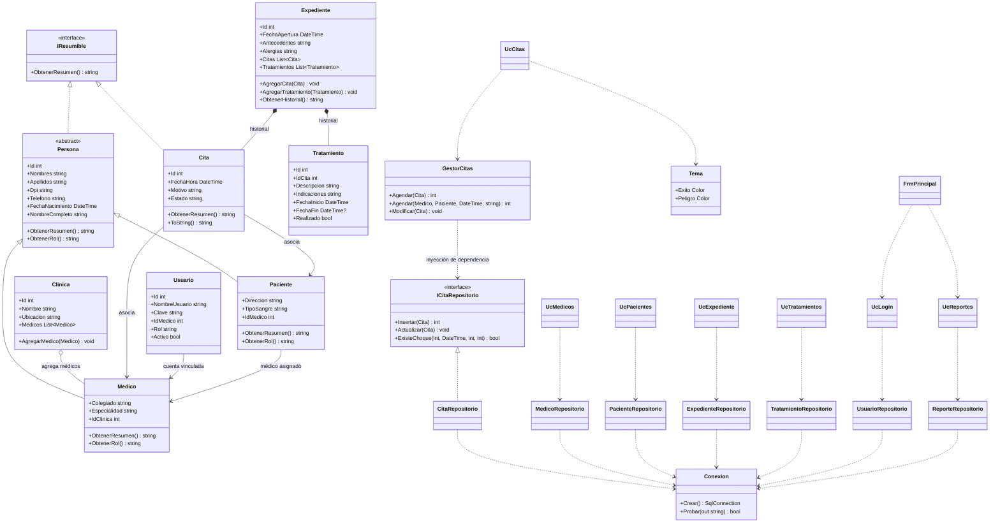
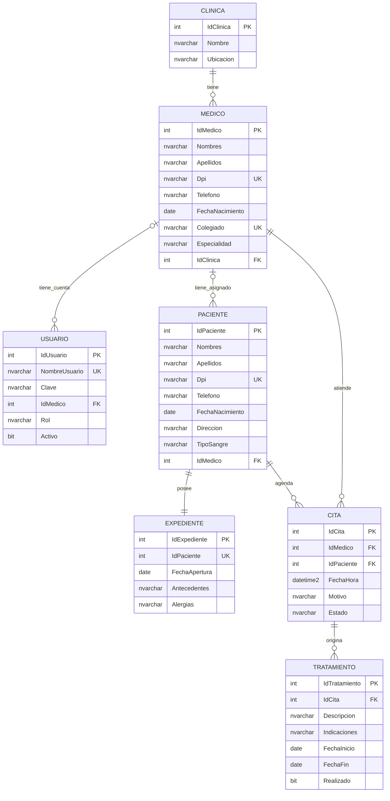

# Informe de requerimientos y diseño

> **Referencia al PDF:** el PDF de requisitos no está disponible en los archivos del proyecto ni en los adjuntos revisados. La columna “Punto del PDF” queda marcada como pendiente para completar con la sección o página exacta cuando se tenga ese documento. Los requerimientos de esta tabla se basan en el contexto entregado para el proyecto.

## Requerimientos funcionales

| ID | Requerimiento | Rol(es) | Pantalla o archivo que lo cumple | Punto del PDF |
|---|---|---|---|---|
| RF-01 | Iniciar sesión con usuario y clave; rechazar credenciales incorrectas. | Administrador, Médico, Recepción | `Controles/UcLogin.cs`, `UsuarioRepositorio.Validar` | Pendiente: PDF no proporcionado |
| RF-02 | Cerrar sesión y volver a la pantalla de acceso. | Todos | `FrmPrincipal.cs`, `Sesion.Cerrar` | Pendiente: PDF no proporcionado |
| RF-03 | Mostrar navegación según el rol autenticado. | Administrador, Médico, Recepción | `FrmPrincipal.AplicarRol` | Pendiente: PDF no proporcionado |
| RF-04 | Consultar y guardar los datos de la clínica; mostrar médicos asociados. | Administrador | `Controles/UcClinica.cs`, `ClinicaRepositorio` | Pendiente: PDF no proporcionado |
| RF-05 | Buscar, crear, editar y eliminar médicos. Recepción cuenta con consulta solamente. | Administrador; Recepción (consulta) | `Controles/UcMedicos.cs`, `Forms/FrmMedico.cs`, `MedicoRepositorio` | Pendiente: PDF no proporcionado |
| RF-06 | Administrar pacientes (crear, editar, eliminar), asignarles un médico y consultar sus datos. El médico solo consulta los pacientes que tiene asignados. | Administrador, Recepción (mantenimiento); Médico (consulta asignada) | `UcPacientes.cs`, `FrmPaciente.cs`, `PacienteRepositorio` | Pendiente: PDF no proporcionado |
| RF-07 | Consultar, agendar, editar, cancelar, atender y eliminar citas; el médico solo consulta sus citas. En el formulario solo aparecen pacientes asignados al médico seleccionado. | Administrador, Recepción (gestión); Médico (consulta asignada) | `UcCitas.cs`, `FrmCita.cs`, `GestorCitas`, `CitaRepositorio` | Pendiente: PDF no proporcionado |
| RF-08 | Validar datos, fecha futura y choque de horario de 30 minutos, y comprobar en SQL Server que el paciente esté asignado al médico de la cita. | Administrador, Recepción | `GestorCitas.Agendar`, `GestorCitas.Modificar`, `CitaRepositorio.ExisteChoque`, `CitaRepositorio.ValidarAsignacion` | Pendiente: PDF no proporcionado |
| RF-09 | Administrar tratamientos: Administración puede crear, editar, marcar realizados y eliminar; el médico puede crear, editar y marcar realizados solo en las citas de sus pacientes asignados, pero no eliminar. | Administrador, Médico | `UcTratamientos.cs`, `FrmTratamiento.cs`, `TratamientoRepositorio` | Pendiente: PDF no proporcionado |
| RF-10 | Consultar expedientes e historiales y editar antecedentes y alergias. El médico solo puede hacerlo con pacientes asignados; el repositorio comprueba la asignación al actualizar. | Administrador, Médico | `UcExpediente.cs`, `ExpedienteRepositorio`, `Expediente.ObtenerHistorial` | Pendiente: PDF no proporcionado |
| RF-11 | Consultar citas filtradas por médico y por paciente. | Administrador, Recepción | `Controles/UcReportes.cs`, `ReporteRepositorio.CitasPorMedico`, `ReporteRepositorio.CitasPorPaciente` | Pendiente: PDF no proporcionado |
| RF-12 | Consultar tratamientos realizados. | Administrador, Recepción | `Controles/UcReportes.cs`, `ReporteRepositorio.TratamientosRealizados` | Pendiente: PDF no proporcionado |
| RF-13 | Consultar el historial médico de un paciente. | Administrador, Recepción | `Controles/UcReportes.cs`, `ExpedienteRepositorio` | Pendiente: PDF no proporcionado |
| RF-14 | Consultar un directorio común de médicos y pacientes y sus resúmenes. | Administrador, Recepción | `Controles/UcReportes.cs`, `Persona.ObtenerResumen`, `IResumible` | Pendiente: PDF no proporcionado |
| RF-15 | Guardar la clave del usuario y compararla directamente al validar el acceso. | Todos | `UsuarioRepositorio.Validar` | Pendiente: PDF no proporcionado |
| RF-16 | Usar consultas parametrizadas y restricciones de base de datos para evitar datos relacionados inválidos. | Sistema | Archivos `LibreriaClases/Datos/*.cs`, `ClinicaDB.sql` | Pendiente: PDF no proporcionado |

## Requerimientos no funcionales

- La aplicación de escritorio se desarrolla con Windows Forms sobre .NET 10 (`net10.0-windows`).
- Los datos se almacenan en SQL Server LocalDB en la base `ClinicaDB`.
- Las consultas usan parámetros SQL y el acceso a datos se concentra en repositorios.
- Cada ventana y vista se diseña en el diseñador gráfico de Visual Studio: su aspecto está en un archivo `.Designer.cs` y su lógica en un archivo `.cs` de la misma clase parcial.
- Los controles comparten la misma paleta de colores y la misma fuente (Segoe UI), escritas directamente en cada `.Designer.cs`. `GestionClinica.UI/Estilo/Tema.cs` conserva los colores que se usan desde código.
- Las pantallas no consultan la base de datos mientras se editan en el diseñador (la carga de datos se hace en el evento `Load` y se omite con `DesignMode`).
- Las operaciones de lectura o escritura deben responder en un tiempo razonable para el tamaño de una clínica pequeña; no se definió una meta numérica de rendimiento.
- Los errores del backend se muestran al usuario en cuadros de mensaje para facilitar su corrección.

## Diagrama de clases

Cada clase de la interfaz (`FrmPrincipal`, `Uc*` y `Frm*`) está dividida en dos archivos mediante `partial class`: el `.Designer.cs` (controles y diseño) y el `.cs` (lógica). El diagrama las muestra como una sola clase.

## Diagrama entidad-relación

## Reglas actuales por rol

| Función | Administración | Recepción | Médico |
|---|---|---|---|
| Mantenimiento de médicos | Sí | Consultar | No |
| Crear, editar, eliminar pacientes y asignar médico | Sí | Sí | No |
| Consultar pacientes | Todos | Todos | Solo asignados |
| Agendar o modificar citas | Sí | Sí | No |
| Consultar citas | Todas | Todas | Solo las propias asignadas |
| Crear o actualizar tratamientos | Sí | Según acceso mostrado en menú (no disponible) | Sí, solo asignados |
| Eliminar tratamientos | Sí | No | No |
| Editar antecedentes y alergias | Sí | No | Sí, solo asignados |
| Reportes generales | Sí | Sí | No |

El menú se controla en `FrmPrincipal.AplicarRol`; los repositorios incorporan comprobaciones para que los permisos no dependan solamente de ocultar botones. La asignación de paciente se guarda en `Paciente.IdMedico`, y la cuenta médica tiene el identificador en `Usuario.IdMedico`.

## Recorrido de una cita

1. Administración o Recepción escoge médico en `FrmCita`.
2. El formulario filtra la lista de pacientes a los asignados.
3. `GestorCitas` valida fecha, motivo, estado y traslapes de 30 minutos.
4. `CitaRepositorio` comprueba la asignación en SQL Server y guarda los datos mediante parámetros.
5. Los médicos consultan sus citas y pueden documentar tratamientos y antecedentes de pacientes asignados.

## Conceptos de POO

| Concepto | Dónde se ve | Archivo y método |
|---|---|---|
| Abstracción | `Persona` define atributos y comportamiento común, pero no se instancia directamente. | `Modelos/Persona.cs`, clase `Persona` |
| Herencia | Médico y paciente reutilizan y amplían la clase persona. | `Modelos/Medico.cs`, `Modelos/Paciente.cs` |
| Polimorfismo dinámico | Cada clase hija implementa sus propios resúmenes y roles con `override`. | `Medico.ObtenerResumen`, `Paciente.ObtenerResumen` |
| Polimorfismo estático | Hay dos firmas de `Agendar`; y dos sobrecargas de `Listar` para médicos y pacientes. | `Logica/GestorCitas.cs`, `Datos/MedicoRepositorio.cs`, `Datos/PacienteRepositorio.cs` |
| Encapsulamiento | Los setters validan nombres y fecha antes de guardar los valores. | `Modelos/Persona.cs`, propiedades `Nombres`, `Apellidos`, `FechaNacimiento` |
| Interfaces | `IResumible` expresa capacidad compartida sin imponer herencia entre `Cita` y `Persona`. | `Interfaces/IResumible.cs`, `Modelos/Cita.cs` |
| DIP e inyección | El gestor depende del contrato `ICitaRepositorio` y lo recibe en su constructor. | `Logica/GestorCitas.cs`, constructor |
| Agregación | La clínica mantiene una lista de médicos que pueden existir independientemente. | `Modelos/Clinica.cs`, `AgregarMedico` |
| Composición | El expediente organiza sus listas de citas y tratamientos y genera el historial. | `Modelos/Expediente.cs`, `AgregarCita`, `AgregarTratamiento`, `ObtenerHistorial` |
| Asociación | Una cita relaciona un médico y un paciente. | `Modelos/Cita.cs`, propiedades `Medico` y `Paciente` |
| Dependencia | Los repositorios obtienen conexiones desde una clase centralizada; las pantallas usan repositorios. | `Datos/Conexion.cs`, `GestionClinica.UI/Controles/*.cs` |
| Clases parciales y herencia de la interfaz | Cada ventana hereda de `Form` o `UserControl` y se reparte en dos archivos de una misma clase: diseño y lógica. | `Controles/UcCitas.cs` y `Controles/UcCitas.Designer.cs`; `Forms/FrmCita.cs` y `Forms/FrmCita.Designer.cs` |

## Preguntas probables para la defensa

1. **¿Por qué `Persona` es abstracta?**  
   Porque agrupa los datos comunes, pero el sistema crea médicos o pacientes concretos. Cada clase hija define su propio resumen.

2. **¿Cuál es la diferencia entre `IResumible` y `Persona`?**  
   `Persona` representa una relación “es un” para médico y paciente. `IResumible` representa una capacidad que también puede tener `Cita`.

3. **¿Qué diferencia hay entre sobrecarga y `override`?**  
   La sobrecarga ofrece métodos del mismo nombre con parámetros distintos y se decide al compilar. `override` reemplaza un método virtual o abstracto y se decide al ejecutar.

4. **¿Por qué `GestorCitas` recibe `ICitaRepositorio`?**  
   Así depende de lo que el repositorio puede hacer, no de una clase concreta. Se puede cambiar la implementación sin reescribir las reglas del gestor.

5. **¿Cómo se evita que se agenden citas traslapadas?**  
   `GestorCitas` valida los datos y pregunta a `ICitaRepositorio` si existe otra cita activa del mismo médico dentro del intervalo permitido de 30 minutos.

6. **¿Por qué se parametrizan las consultas SQL?**  
   Los valores se envían separados del texto SQL, lo que reduce errores de formato y evita que entradas del usuario se interpreten como parte de la consulta.

7. **¿Por qué cada pantalla tiene un archivo `.Designer.cs` y otro `.cs`?**  
   Es una clase parcial (`partial class`). El diseñador de Visual Studio escribe en el `.Designer.cs` los controles, sus posiciones, colores y eventos dentro de `InitializeComponent()`. La lógica va en el `.cs`, que no se pierde cuando el diseñador regenera su archivo.

8. **¿Por qué los datos se cargan en el evento `Load` y no en el constructor?**  
   Para que el diseñador de Visual Studio pueda abrir la pantalla sin conectarse a la base de datos. Además, `if (DesignMode) return;` evita cualquier consulta mientras se edita el diseño.

## Preguntas adicionales para la defensa

9. **¿Para qué sirve `Paciente.IdMedico`?** Para guardar qué médico tiene asignado el paciente; el ComboBox de citas filtra por ese valor.

10. **¿Por qué validar otra vez en `CitaRepositorio`?** Porque ocultar opciones en la interfaz no garantiza que los datos sean correctos. El repositorio consulta SQL antes de guardar.

11. **¿Qué puede modificar un médico?** Tratamientos y antecedentes/alergias de pacientes asignados. No puede modificar la ficha personal del paciente ni eliminar tratamientos.

12. **¿Qué significa `Load`?** Es un evento de Windows Forms que se dispara al cargarse un formulario o `UserControl`. Se utiliza para llenar las listas y tablas cuando los controles ya están inicializados. `DesignMode` evita abrir la conexión mientras se edita visualmente.

13. **¿Por qué el paciente se asigna al crear o editar?** Para que las citas, consultas y expedientes puedan limitarse al médico que le corresponde.

14. **¿Las contraseñas en texto plano son seguras?** No. Se adoptó esa simplificación para una demostración local; un sistema real debe almacenar hashes de contraseña con un algoritmo apropiado y sal, nunca claves visibles.

**Pendiente:** cotejar los requerimientos RF con el PDF original del curso, si se proporciona. Las descripciones reflejan el código actual, no una certificación de cumplimiento del documento del docente.
